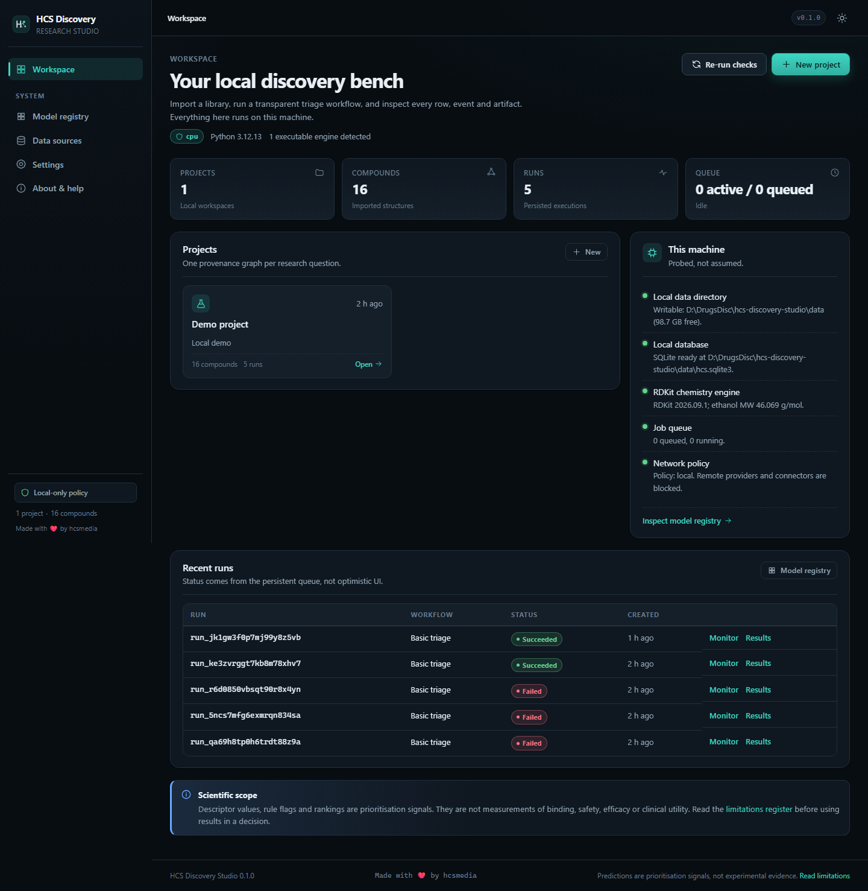
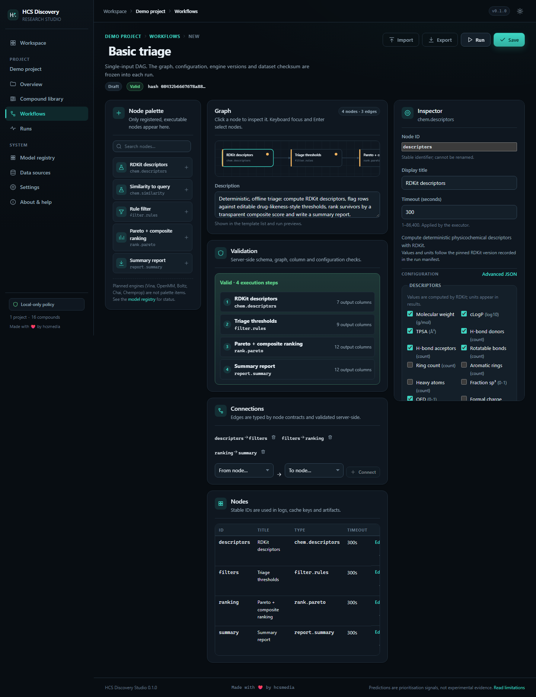
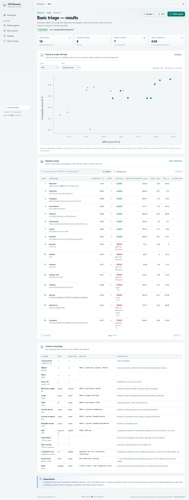
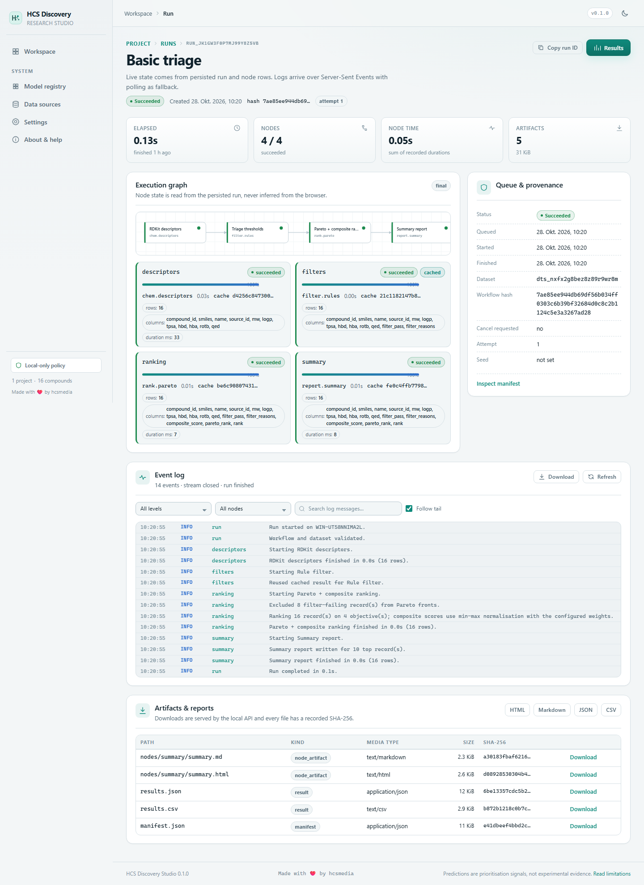
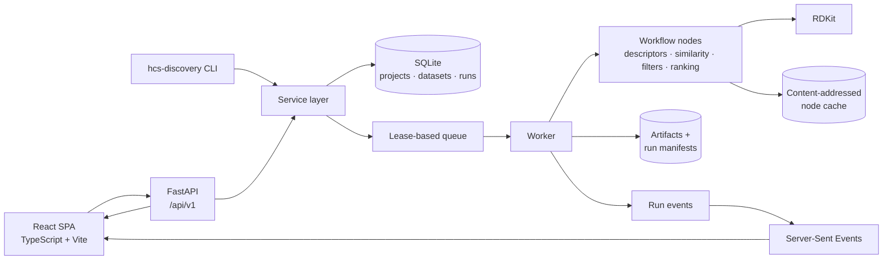

<p align="center">
  
</p>

# HCS Discovery Studio

**Open science. Reproducible discovery. Made with ❤️ by hcsmedia.**

A local-first, open-source workbench for reproducible computational
drug-discovery research. Import a compound library, run transparent triage
and docking workflows, inspect every row, event and artifact, and automate the same pipeline
from the CLI or HTTP API — without Docker, CUDA, an account, or a cloud key.

[](https://github.com/timfromhcs/hcs-discovery-studio/actions/workflows/ci.yml)
[](https://github.com/timfromhcs/hcs-discovery-studio/actions/workflows/codeql.yml)
[](LICENSE)
[](pyproject.toml)
[](docs/engineering/IMPLEMENTATION_STATUS.md)



## What this is

HCS Discovery Studio is a working vertical slice of an open scientific
workbench. It is built around one idea: **every result should be inspectable and
reproducible**, whether it came from the UI, the CLI, or the API.

- **Local-first.** The core demo runs offline on CPU after installation. The
  default network policy is `local`; remote providers and connectors are blocked.
- **One provenance graph.** Projects, datasets, compounds, workflows, runs,
  events and artifacts are linked in SQLite, with content hashes and immutable
  run manifests.
- **Transparent ranking.** RDKit descriptors, explicit rule filters, Pareto
  fronts and a weighted composite score. Weights are visible; rejected rows stay
  visible; nothing is hidden behind an opaque “drug score”.
- **Headless parity.** Every shipped UI action has a CLI and `/api/v1`
  equivalent. Long jobs expose status, logs, cancellation, failure reasons and
  artifacts.
- **Honest scope.** RDKit chemistry, AutoDock Vina CPU docking (when the
  official binary is installed) and two literature property estimates run
  locally. MD, learned ADMET models and structure prediction are registry cards
  marked `planned`; they cannot be run.

This is **not** a clinical decision system, a regulator-approved medical device,
or evidence of binding, safety or efficacy. Predictions and rankings are
prioritisation signals. Read
[Scientific limitations](docs/user-guide/SCIENTIFIC_LIMITATIONS.md).

## Working now (verified locally and in CI)

| Capability | Status | Evidence |
|---|---|---|
| CSV, SDF and SMILES import with row-level errors | **Available** | 16/17 demo rows imported; failures retained |
| RDKit standardisation, descriptors and Morgan/Tanimoto similarity | **Available** | Deterministic fixture tests |
| AutoDock Vina CPU docking | **Host-dependent** | Needs the official Vina 1.2.x binary; flexible-ligand PDBQT matches Meeko on 48/51 fixtures ([report](docs/validation/ligand-prep-meeko.md)); no redocking benchmark yet |
| Literature property estimates (ESOL, CNS MPO) | **Available** | Reduced ESOL: RMSE 0.97, R² 0.07 on 45 measured compounds ([report](docs/validation/esol-solubility.md)); CNS MPO is an approximation (cLogP for ClogD, assumed pKa) |
| Bemis-Murcko generic scaffold splitting | **Available** | Leakage-free split validation tests |
| PubChem & ChEMBL public data connectors | **Available** | NCBI & EBI REST search with policy-gated access |
| DAG branching & table joins | **Available** | Kahn topological sort, fan-out, and `table.join` |
| Deb's Fast Non-dominated Sorting & Pareto ranking | **Available** | Multi-objective sorting invariant tests |
| Safe local research assistant | **Available** | Ask, Plan, Run modes with strict allowlisted tools |
| Persistent lease-based queue & restart recovery | **Available** | Queue/worker integration tests |
| Bounded cache lifecycle & cascade deletion | **Available** | Size/age pruning and orphan cleanup tests |
| Report export & table truncation disclosures | **Available** | Markdown/HTML truncation notices & full CSV/JSON/SDF export |
| React UI for project → import → workflow → run → results | **Available** | 3 Playwright E2E tests |
| CLI and versioned HTTP API | **Available** | Shared domain services; CLI integration tests |
| Self-contained wheel with bundled SPA | **Available** | Built and smoke-tested without Node runtime |
| OpenMM, Boltz-2, Chai-1 | **Planned** | Tracked honestly in model registry |

The full ledger, including partial features and known defects, is in
[Implementation status](docs/engineering/IMPLEMENTATION_STATUS.md).

## Quick start

### Option A — source checkout (recommended for development)

Requirements: **Python 3.12 or 3.13**, [uv](https://docs.astral.sh/uv/), and
**Node.js 22.12 or newer** (Vite 8 requires Node 20.19+ or 22.12+) for the
frontend.

```bash
git clone https://github.com/timfromhcs/hcs-discovery-studio.git
cd hcs-discovery-studio
uv sync --dev
cd apps/web && npm ci && npm run build && cd ../..
uv run hcs-discovery doctor
uv run hcs-discovery serve
```

Open <http://127.0.0.1:8787>. The server embeds a worker, so queued runs execute
without a second process.

For frontend hot reload, run the API on `8787` and Vite separately:

```bash
uv run hcs-discovery serve --port 8787
cd apps/web && npm run dev        # http://127.0.0.1:5173, proxies /api to 8787
```

### Option B — release wheel

Download the wheel from the
[latest release](https://github.com/timfromhcs/hcs-discovery-studio/releases/latest)
(`v2.0.0` is published there only once all release gates pass).
It bundles the built UI:

```bash
python -m venv .venv
. .venv/bin/activate              # Windows: .venv\Scripts\Activate.ps1
pip install hcs_discovery_studio-2.0.0-py3-none-any.whl
hcs-discovery doctor
hcs-discovery serve
```

Verify release assets with `SHA256SUMS.txt` and the GitHub build-provenance
attestation (commands are in the release notes).

### Run the demo workflow from the CLI

```bash
uv run hcs-discovery project create --name "Demo project"
uv run hcs-discovery dataset import examples/datasets/demo_library.csv --project <project-id>
uv run hcs-discovery workflow run examples/workflows/triage.yaml --project <project-id> --dataset <dataset-id>
uv run hcs-discovery run status <run-id>
uv run hcs-discovery report export <run-id> --format html --output report.html
```

The CLI uses the same service layer as the API. Add `--json` before or after a
subcommand for machine-readable output. See the [CLI guide](docs/user-guide/CLI.md).

## A look at the application

| Workspace | Workflow editor |
|---|---|
|  |  |
| **Results and Pareto trade-off** | **Live run monitor** |
|  |  |

More genuine captures, including light/dark and narrow layouts, are in
[`docs/screenshots/`](docs/screenshots/). They were produced with Playwright
against the running application; no mockups are used.

## Architecture



A workflow is a typed table flowing through single-input nodes. Multi-input
merges are explicitly rejected rather than silently mis-executed. The queue is
persistent and lease-based with **at-least-once** execution; node results are
cached by node type, implementation version, configuration, input hash and
engine versions. See [Workflow engine](docs/architecture/WORKFLOW_ENGINE.md) and
[Data model](docs/architecture/DATA_MODEL.md).

## Reproducibility and provenance

Every run records:

- the immutable workflow snapshot and validated configuration;
- dataset identity, source, schema and SHA-256 checksum;
- per-node status, timings, cache keys and errors;
- Python, application, RDKit and dependency versions;
- host, OS, CPU and backend description;
- artifact paths, media types, sizes and SHA-256 checksums;
- explicit scientific limitations and the run’s terminal status.

A rerun with the same inputs, configuration and engine versions can reuse cached
node outputs. This is **not** a claim of bit-identical results across different
RDKit or dependency versions. See
[Reproducibility policy](docs/user-guide/SCIENTIFIC_LIMITATIONS.md#reproducibility-is-not-validity).

## Hardware and backend matrix

| Path | Status | Notes |
|---|---|---|
| CPU x86-64, Windows 11 | **Verified locally** | Ryzen 7 7735HS, 19.8 GB RAM, Python 3.12 |
| CPU x86-64, Linux | **Verified in CI** | Ubuntu runner, Python 3.12 |
| Vulkan | **Probed only** | Vulkan 1.4.357 device detected; no scientific model claims Vulkan execution |
| CUDA | **Not required, not used** | No CUDA dependency in the base install |
| GPU acceleration | **Not claimed** | CPU is the dependable baseline |
| macOS / ARM64 | **Untested** | No release claim |

`hcs-discovery doctor` reports what the current machine can actually do. It
never labels a model Vulkan-compatible unless that adapter has a real probe.

## Testing and CI

| Gate | Command | Result |
|---|---|---|
| Backend tests | `uv run pytest -q` | 82 passed locally and in CI |
| Coverage | `uv run pytest --cov=hcs_discovery` | 75% locally; CI floor 70% |
| Python format/lint/type | `uv run ruff format --check .`, `uv run ruff check .`, `uv run mypy` | Clean locally and in CI |
| Frontend typecheck/build | `npm run typecheck`, `npm run build` in `apps/web` | Clean locally and in CI |
| End-to-end | `npm run test:e2e` in `apps/web` | 3 passed locally and in CI |
| License policy | `uv run python scripts/ci/check_licenses.py`, `node scripts/ci/check_licenses.mjs` | Pass locally and in CI |
| Dependency audit | `pip-audit`, `npm audit --omit=dev` | No known vulnerabilities at release time |
| Secret scan | gitleaks | Pass in CI on full history |
| Static analysis | CodeQL (Python, TypeScript) | Pass in CI |

CI runs backend gates on **Ubuntu and Windows**, frontend typecheck/build,
Playwright E2E on Linux, a clean SQLite migration, a wheel install/health smoke
test, license and dependency audits, secret scanning, dependency review and
CodeQL. The release-candidate runs are
[CI 40676916640](https://github.com/timfromhcs/hcs-discovery-studio/actions/runs/40676916640)
and
[CodeQL 40676916587](https://github.com/timfromhcs/hcs-discovery-studio/actions/runs/40676916587).
See [Testing](docs/developer-guide/TESTING.md) for the layer-by-layer
methodology and how to reproduce each result.

## Security

- Loopback-only binding by default; non-loopback binding requires a bearer token.
- Local-only network policy blocks remote providers and connectors by default.
- CSP, security headers, request IDs, payload limits, rate limiting and redacted
  error envelopes.
- Secrets are read from environment variables only and are never written to the
  database, logs, reports or screenshots.
- No telemetry or analytics.

Report vulnerabilities privately as described in [SECURITY.md](SECURITY.md). The
threat model and residual risks are in
[Threat model](docs/security/THREAT_MODEL.md).

## Known limitations

- **Docking is not benchmarked.** Vina runs and its ligand preparation is
  checked against Meeko, but no redocking/pose-recovery benchmark has been run.
  Receptors must be prepared PDBQT files under `<HCS_DATA_DIR>/receptors`.
- **Property estimates are weak.** Reduced ESOL barely beats a constant
  baseline on independent data; CNS MPO approximates ClogD and pKa. Neither
  reports a calibrated uncertainty. MD, learned ADMET and structure prediction
  are not implemented.
- **DAGs without loops.** Fan-out and key-based `table.join` are supported; no
  loops, conditionals, sub-workflows or parameter sweeps.
- **Single machine.** SQLite and a local queue; no PostgreSQL deployment,
  distributed workers or multi-tenant isolation.
- **Research agent is rule-based by default.** Ask/Plan/Run use allowlisted
  tools; Ask uses a configured local LLM when available and says so when it
  falls back to built-in rules.
- **SQLite on one machine.** Writers are serialised; no distributed workers.
- **No TLS or reverse proxy.** Put a hardened proxy in front of any non-local
  deployment.
- **Node cache entries outlive projects.** They are content-addressed and
  shared; `hcs-discovery cache prune` applies the size and age limits.

The complete list, including partial features and risks, is in
[Implementation status](docs/engineering/IMPLEMENTATION_STATUS.md#known-defects-and-risks).

## Troubleshooting

| Symptom | Fix |
|---|---|
| `program not found` for `uv run hcs …` | The executable is `hcs-discovery`, not `hcs`. |
| UI shows “frontend not built” | Run `npm ci && npm run build` in `apps/web`, or install the release wheel. |
| Port already in use | `hcs-discovery serve --port 8790`; check `hcs-discovery doctor`. |
| Non-loopback bind refused | Set `HCS_API_TOKEN` and pass `--host 0.0.0.0`; TLS is not included. |
| RDKit import fails | Use Python 3.12 or 3.13 and reinstall with `uv sync --dev`. |
| Need a clean local state | Stop the server, then remove `data/` (destructive) and run `hcs-discovery db upgrade`. |
| E2E port conflict | The Playwright config uses `127.0.0.1:8791` and `.e2e-data`; stop other servers first. |

More help: [Windows install](docs/user-guide/INSTALL_WINDOWS.md),
[Linux install](docs/user-guide/INSTALL_LINUX.md),
[Quick start](docs/user-guide/QUICKSTART.md),
[Workflows](docs/user-guide/WORKFLOWS.md).

## Documentation

- **User guide:** [Quick start](docs/user-guide/QUICKSTART.md) ·
  [CLI](docs/user-guide/CLI.md) · [Workflows](docs/user-guide/WORKFLOWS.md) ·
  [Local models](docs/user-guide/LOCAL_MODELS.md) ·
  [Scientific limitations](docs/user-guide/SCIENTIFIC_LIMITATIONS.md)
- **Architecture:** [Overview](docs/architecture/OVERVIEW.md) ·
  [Workflow engine](docs/architecture/WORKFLOW_ENGINE.md) ·
  [Data model](docs/architecture/DATA_MODEL.md) ·
  [Plugin API](docs/architecture/PLUGIN_API.md)
- **Engineering:** [Implementation status](docs/engineering/IMPLEMENTATION_STATUS.md) ·
  [Agent log](docs/engineering/AGENT_LOG.md)
- **Research and validation:** [Component/license audit](docs/research/COMPONENT_AND_LICENSE_AUDIT.md) ·
  [Validation protocol](docs/scientific-validation/VALIDATION_PROTOCOL.md)
- **Security:** [Threat model](docs/security/THREAT_MODEL.md) · [SECURITY.md](SECURITY.md)
- **Contributing:** [CONTRIBUTING.md](CONTRIBUTING.md) ·
  [Developer guide](docs/developer-guide/CONTRIBUTING.md) ·
  [Testing](docs/developer-guide/TESTING.md) · [Code of conduct](CODE_OF_CONDUCT.md)

## Citation

If you use this work, cite the repository using [CITATION.cff](CITATION.cff):

```bibtex
@software{hcs_discovery_studio_2026,
  author  = {hcsmedia},
  title   = {HCS Discovery Studio},
  year    = {2026},
  version = {2.0.0},
  url     = {https://github.com/timfromhcs/hcs-discovery-studio},
  license = {Apache-2.0}
}
```

## License

Original project code is licensed under **Apache-2.0**; see [LICENSE](LICENSE).
Third-party components retain their own licenses and attribution; see
[NOTICE](NOTICE) and the
[component and license audit](docs/research/COMPONENT_AND_LICENSE_AUDIT.md).
No third-party model weights or proprietary datasets are bundled.

---

**Status:** `2.0.0` release candidate in preparation; it is published only after
the local gates and cloud CI pass for the tagged commit. See `IMPLEMENTATION_STATUS.md` for the full feature ledger and `CHANGELOG.md` for the change list.
