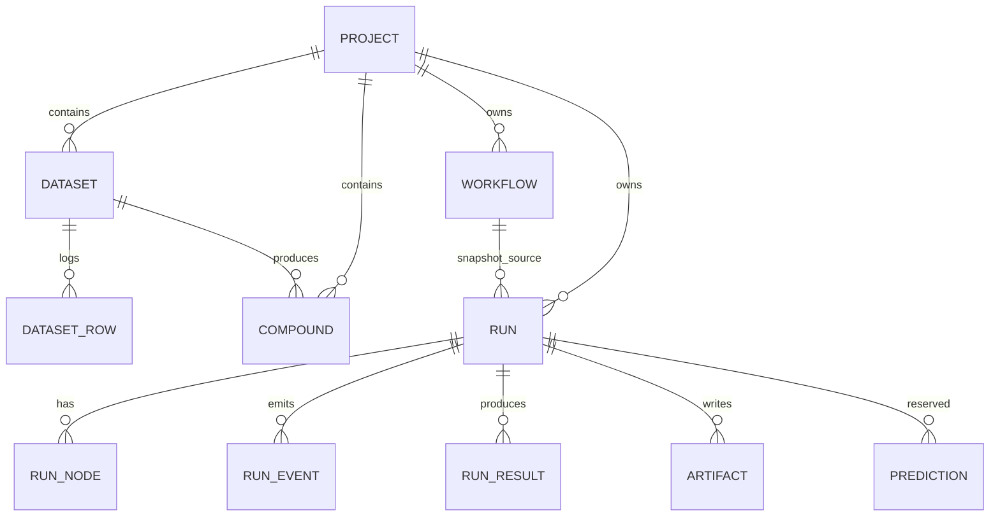

# Data model

The database is SQLite by default, accessed through SQLAlchemy 2 and migrated
with Alembic. The schema is intentionally small and inspectable. This document
describes the shipped schema; tables marked **reserved** exist for forward
compatibility and are not yet exercised by a user-facing feature.

## Identifiers

Primary keys are self-describing prefixed strings:

| Entity | Prefix | Example |
|---|---|---|
| Project | `prj_` | `prj_hhap36j0c413bdw911v5` |
| Dataset | `dts_` | `dts_nxfx2g8bez8z89r9wr8m` |
| Compound | `cmp_` | `cmp_...` |
| Workflow | `wfl_` | `wfl_...` |
| Run | `run_` | `run_jk1gw3f0p7mj99y8z5vb` |

IDs are generated with a time-ordered component plus randomness, so they sort
usefully without exposing sequence counts.

All timestamps are naive UTC, produced by `db_now()`. API responses add `Z` or
an explicit UTC offset at the boundary.

## Entity relationships



## Tables

### `projects`

`id`, `name`, `description`, `purpose`, `created_at`, `updated_at`.

A project is the top-level container. Deleting a project cascades to its
datasets, compounds, workflows and runs.

### `datasets`

`id`, `project_id`, `name`, `source_format`, `original_filename`, `sha256`,
`record_count`, `imported_count`, `error_count`, `source_url`, `license`,
`transformation_log`, `column_mapping`, `created_at`.

The SHA-256 is the checksum of the uploaded file. `transformation_log` records
standardisation choices; `column_mapping` records which CSV columns were used
for structure, name and source ID.

### `dataset_rows`

`id`, `dataset_id`, `row_index`, `status`, `raw`, `error`, `compound_id`.

Every input row is retained, including failures. This is what makes row-level
error reporting auditable. `status` is `imported`, `error` or `duplicate`.

### `compounds`

`id`, `project_id`, `dataset_id`, `source_row_index`, `source_id`, `name`,
`input_smiles`, `canonical_smiles`, `isomeric_smiles`, `inchi`, `inchikey`,
`formula`, `formal_charge`, `warnings`, `created_at`.

Both the raw input and the standardised forms are stored. Duplicate structures
are kept rather than silently collapsed, so the import count matches the source
file and duplicates remain visible for audit.

### `workflows`

`id`, `project_id`, `name`, `description`, `schema_version`, `definition`,
`content_hash`, `created_at`, `updated_at`.

`definition` is the validated JSON form of the YAML workflow.
`(project_id, name)` is unique. `content_hash` is the stable hash of the
definition used for provenance.

### `runs`

`id`, `project_id`, `workflow_id`, `dataset_id`, `workflow_name`,
`workflow_snapshot`, `workflow_hash`, `status`, `parameters`, `seed`, `attempt`,
`cancel_requested`, `error`, `manifest`, `lease_owner`, `lease_expires_at`,
`heartbeat_at`, `created_at`, `started_at`, `finished_at`.

`workflow_snapshot` is immutable for the life of the run. Editing or deleting a
saved workflow does not change an existing run. `status` is `queued`, `running`,
`succeeded`, `failed` or `cancelled`.

### `run_nodes`

`id`, `run_id`, `node_id`, `node_type`, `status`, `progress`, `cache_key`,
`cached`, `summary`, `error`, `started_at`, `finished_at`.

One row per node per run, unique on `(run_id, node_id)`. `cache_key` is the
content-addressed key described in `WORKFLOW_ENGINE.md`. `cached` records
whether the output came from the cache.

### `run_events`

`id`, `run_id`, `seq`, `ts`, `type`, `level`, `message`, `node_id`, `data`.

Append-only log with unique `(run_id, seq)`. Messages are redacted and truncated
to 8,000 characters before storage. The SSE endpoint and the CLI read the same
rows.

### `run_results`

`id`, `run_id`, `compound_id`, `rank`, `composite_score`, `pareto_front`,
`rejected`, `reasons`, `metrics`.

One row per compound per run. `metrics` stores numeric output columns keyed by
column name. Rejected rows keep their reasons and are not assigned a Pareto
rank.

### `artifacts`

`id`, `run_id`, `node_id`, `kind`, `rel_path`, `media_type`, `size_bytes`,
`sha256`, `created_at`.

Paths are relative to the run directory and validated against traversal.
`sha256` is computed at write time.

### `audit_events`

`id`, `ts`, `actor`, `action`, `object_type`, `object_id`, `outcome`,
`metadata`.

Written for project create/delete, dataset import/delete, workflow save and run
submission. There is no audit viewer in the UI yet.

### Reserved tables

- `targets` — target metadata (gene symbol, UniProt ID, organism, notes).
- `structures` — structure files with source, accession, format and checksum.
- `predictions` — endpoint predictions with method, version, unit, direction
  and warnings.

These tables are migrated but have no service or UI workflow in 0.1.0. They are
listed here so the schema is not mistaken for a shipped feature.

## Files on disk

```text
data/
  hcs.sqlite3
  runs/<run_id>/
    results.json
    results.csv
    manifest.json
    nodes/<node_id>/...
  cache/<xx>/<key>/
    entry.json
    artifacts/...
  uploads/
  logs/
```

The database is the index; the run directory is the evidence. Deleting a run
row does not automatically delete its directory in this release. Deleting a
project cascades database rows but leaves run directories on disk; clean them
manually if required.

## Migrations

Alembic is the schema authority. `init_db` upgrades to head, stamps legacy
databases that already match the schema, and falls back to `create_all` only
when migration assets are unavailable (for example a minimal wheel install).

```bash
hcs-discovery db current
hcs-discovery db upgrade
```

Tests cover a fresh database and the legacy-stamp path. There is no downgrade
support guarantee; back up `data/hcs.sqlite3` before a major upgrade.

## Retention and privacy

- Local data stays local unless you explicitly export it.
- No telemetry, account or remote sync exists.
- Run artifacts can contain your imported structures and names. Treat the
  `data/` directory as sensitive.
- Back up the database and run directory together; a database without its
  artifacts is not reproducible.
