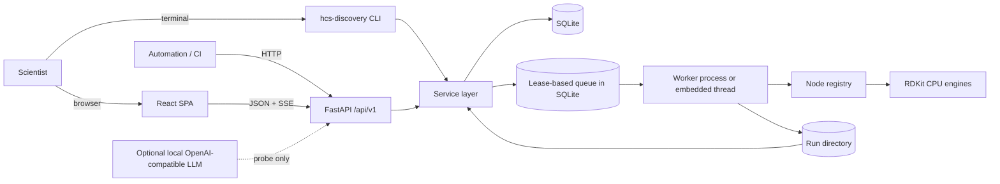

# Architecture overview

HCS Discovery Studio is a local-first application. A single Python process can
serve the API, the bundled React application and an embedded job worker, backed
by SQLite and a local artifact directory. The CLI uses the same service layer as
the API, so every UI action has a headless equivalent.

## System context



There is no required network hop. In the default `local` network policy, remote
LLM endpoints and remote data connectors are blocked. Vulkan is probed for
hardware presence only and is never reported as model support.

## Repository layout

```text
src/hcs_discovery/
  api/            FastAPI app, routes, schemas, rate limiting
  chemistry/      RDKit standardisation, descriptors, depiction
  cli/            Typer CLI (shares services with the API)
  core/           settings, logging, redaction, paths, hashing, diagnostics
  database/       SQLAlchemy models, engine/session, Alembic bridge
  datasets/       CSV/SDF/SMILES readers and row outcomes
  jobs/           persistent queue, lease recovery, worker loop
  plugins/        optional LLM provider and Vulkan probe
  reports/        Markdown/HTML/JSON/CSV report rendering
  schemas/        Pydantic adapter and API payload models
  services/       use cases shared by API and CLI
  workflow/       schema validation, executor, node registry, cache, tables
apps/web/
  src/            React pages, components, API client, design tokens
  e2e/            Playwright end-to-end tests
migrations/       Alembic environment and revisions
tests/            unit, integration, security and migration tests
examples/         demo dataset and workflow
docs/             architecture, user, developer, research, security, status
```

## Request and run lifecycle

1. A dataset is uploaded or imported. The reader records every row outcome,
   standardises structures with RDKit and stores the file SHA-256.
2. A workflow definition is validated statically: node types, one input per
   node, a single root, no cycles, config schema and required columns.
3. A run row is queued with an immutable workflow snapshot, dataset reference
   and optional seed.
4. A worker leases the run, marks it running and executes nodes in topological
   order. Each node gets a content-addressed cache key that includes the node
   type, version, config, input hash, engine versions and implementation hash.
5. Node outputs flow as a typed `Table`. Numeric columns carry a description,
   unit, direction and method.
6. Results are persisted as rows plus `results.json` and `results.csv`.
   Artifacts are hashed with SHA-256 and recorded in the database.
7. A manifest records the workflow snapshot, dataset checksum, environment,
   hardware, node cache keys, artifact checksums and limitations.
8. The UI follows live events over Server-Sent Events; the CLI polls the same
   event stream. Cancellation, retries and restart recovery are handled by the
   queue.

## Why SQLite and a lease queue

The target is a scientist's laptop, not a cluster. SQLite keeps installation
trivial and the database inspectable. A lease-based queue gives at-least-once
execution and recovery from a crashed worker without adding Redis or a broker.
The trade-off is documented honestly: concurrent writers are serialised, and
multi-machine execution is not supported in this release.

## Frontend

The SPA is React 19 + TypeScript + Vite. TanStack Query owns server state.
Charts and the workflow graph are hand-built SVG components rather than a
heavyweight charting or flow library. The design system is a small set of CSS
custom properties with light and dark themes. The production build is copied
into the Python wheel and served by FastAPI at `/`.

## Trust boundaries

| Boundary | Control |
|---|---|
| Browser to local API | Loopback by default; bearer token required for non-loopback bind |
| CLI to local services | Same process, same validation, no privileged bypass |
| Uploaded file to parser | Size and row limits, format detection, per-row errors |
| Node output to filesystem | Sanitised filenames and traversal checks |
| Report/HTML rendering | HTML escaping of imported values |
| Local app to network | `local` policy blocks non-loopback providers in code |
| CI to repository | Least-privilege tokens, pinned actions, no model secrets |

See `docs/security/THREAT_MODEL.md` for the full analysis.

## Related documents

- `WORKFLOW_ENGINE.md` — validation, execution, caching, failure semantics.
- `DATA_MODEL.md` — entities, identifiers and persistence.
- `PLUGIN_API.md` — node and adapter contracts.
- `../engineering/IMPLEMENTATION_STATUS.md` — what is actually shipped.
